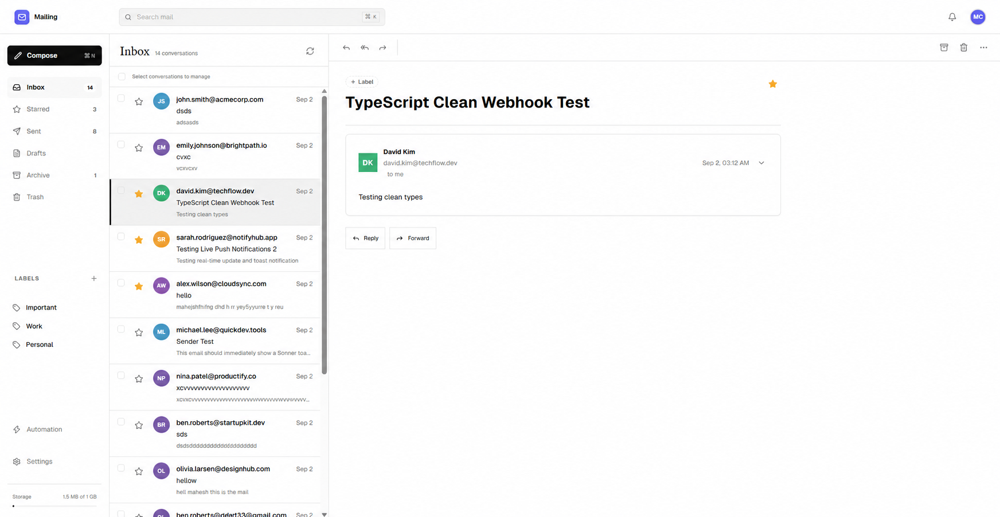

# Mailing - Open-Source Transactional Email Client

Mailing is an open-source, transactional email client built on top of the **Resend API**. It gives you a clean, modern interface to manage, send, and track emails out of the box, without needing to build your own email management UI from scratch.



---

## 📖 Table of Contents
- [Why Mailing?](#why-mailing)
- [Key Features](#key-features)
- [Tech Stack](#tech-stack)
- [Getting Started](#getting-started)
  - [Prerequisites](#prerequisites)
  - [Installation](#installation)
  - [Configuration](#configuration)
  - [Database Setup](#database-setup)
- [Security & Architecture](#security--architecture)
- [Documentation](#documentation)
- [Contributing](#contributing)
- [License](#license)

---

## 🎯 Why Mailing?

Mailing is built for developers, agencies, and teams who want a self-hosted email management interface. It leverages Resend's powerful infrastructure while giving you full control over your data, your UI, and your workflows.

Instead of writing bespoke admin dashboards to view sent emails or debug bounces, Mailing provides a comprehensive Inbox, Sent folder, and settings panel out-of-the-box, supporting multiple users and tenants.

---

## ✨ Key Features

- ✉️ **Send & Receive**: Full email client capabilities including an Inbox, Sent folder, Drafts, and Trash.
- 👥 **Multi-Tenant**: Supports multiple users, each with their own isolated API keys and webhook configurations.
- 🔒 **Secure by Default**: API keys and Webhook secrets are encrypted at rest in the database using `AES-256-GCM` and are never exposed to the client in plaintext.
- ⚡ **Real-Time Webhooks**: Incoming emails, delivery events, and bounces are tracked via Svix-verified webhooks from Resend.
- 🔔 **Real-Time Updates**: Utilizes Pusher to deliver real-time notifications to the dashboard without needing to refresh.

---

## 🛠️ Tech Stack

Mailing is built using a modern, scalable web stack:
- **Framework**: [Next.js](https://nextjs.org/) (App Router)
- **Language**: [TypeScript](https://www.typescriptlang.org/)
- **Styling**: [Tailwind CSS](https://tailwindcss.com/)
- **Database ORM**: [Drizzle ORM](https://orm.drizzle.team/)
- **Database**: PostgreSQL (configurable)
- **Authentication**: [better-auth](https://better-auth.com)
- **Email Delivery**: [Resend](https://resend.com/)
- **Real-time Events**: [Pusher](https://pusher.com/)
- **Testing**: [Vitest](https://vitest.dev/)

---

## 🚀 Getting Started

Follow these instructions to get a local copy of the project up and running.

### Prerequisites

- **Node.js** (v24 or higher)
- **pnpm** (v11.17.0)
- **PostgreSQL** and **BullMQ-compatible Redis** services
- A **Resend** account and API Key
- A **Pusher** account (for real-time notifications)

### Installation

1. **Clone the repository:**
   ```bash
   git clone https://github.com/mahesh2-lab/Mailing.git
   cd Mailing
   ```

2. **Install dependencies:**
   ```bash
   pnpm install
   ```

### Configuration

1. **If you do not already have a `.env`, copy the example environment file:**
   ```bash
   cp .env.example .env
   ```

2. **Fill out `.env`:**
   Open `.env` and fill in the required variables. 
   
   **Crucial:** Generate a secure 32-byte hex string for the `ENCRYPTION_KEY`. You can generate one via terminal:
   ```bash
   node -e "console.log(require('crypto').randomBytes(32).toString('hex'))"
   ```

### Run Locally

Set `DATABASE_URL`, `REDIS_URL`, and the other required values in `.env`, apply checked-in migrations, then start the app and worker in separate terminals:

```bash
pnpm db:migrate
pnpm dev
pnpm workers
```

### Deploy the App on Vercel and the Worker on a VPS

Use this option when the web app should run on Vercel. The VPS only runs the queue worker, so it does not need a domain or inbound web ports. Vercel and the worker must use the same PostgreSQL and BullMQ-compatible Redis services. Managed endpoints are simplest; if these services run on your VPS, Vercel must be able to reach them over the network and they must be secured with TLS, credentials, and firewall rules. Vercel's outbound IPs are dynamic by default; Static IPs can be enabled on Pro or Enterprise for allowlisting. See [Vercel's IP allowlisting guidance](https://vercel.com/kb/guide/how-to-allowlist-deployment-ip-address).

1. In Vercel, import the repository as a Next.js project and set `DATABASE_URL`, `REDIS_URL`, `ENCRYPTION_KEY`, `BETTER_AUTH_SECRET`, `BETTER_AUTH_URL`, `NEXT_PUBLIC_APP_URL`, `INTERNAL_API_SECRET`, and the Pusher variables from `.env.example`. Set `GEMINI_API_KEY` only if AI automations are used. `NEXT_PUBLIC_APP_URL` and `BETTER_AUTH_URL` should be the Vercel production URL.
2. On the VPS, use the existing `.env` or copy `.env.example` to `.env`. Set the same database URL, Redis URL, encryption key, internal API secret, and Pusher server credentials as Vercel. Use a PostgreSQL pooled URL and a Redis TCP URL supported by BullMQ, not a REST-only Redis endpoint.
3. From the repository directory on the VPS, apply migrations once:

   ```bash
   docker compose run --build --rm migrate
   ```

4. Deploy the Vercel app, then start the worker on the VPS:

   ```bash
   docker compose up --build -d worker
   ```

5. Check it with `docker compose logs -f worker`. Configure Resend's webhook to call the Vercel URL at `/api/webhooks/resend`.

If custom HTTP tools were saved before credential encryption was added, run `pnpm encrypt-custom-tool-secrets` once with the same `DATABASE_URL` and `ENCRYPTION_KEY` used by the app.

The destructive database reset requires both `ALLOW_DESTRUCTIVE_DB_RESET=true` and `pnpm reset-db -- --confirm-reset`.

---

## 🔒 Security & Architecture

Security is a first-class citizen in Mailing. 
- **Encryption**: We utilize the `ENCRYPTION_KEY` environment variable to perform `AES-256-GCM` encryption on all sensitive API keys before saving them to the database.
- **Webhook Verification**: We use the `svix` library to securely verify the signature of incoming webhooks from Resend, preventing spoofed requests.
- **Idempotency**: Webhook events are processed idempotently using the `svix-id` to prevent duplicate emails from showing up in your inbox if a delivery event is retried.

For full details, please read our [Security Policy](SECURITY.md).

---

## 📚 Documentation

For more detailed information on configuring and contributing to the project, please refer to the following documents:

- [Webhook Configuration Guide](docs/webhooks.md) - Learn how to connect Resend webhooks to Mailing.
- [Security Policy](SECURITY.md) - Learn more about our encryption and key management.
- [Contributing Guidelines](CONTRIBUTING.md) - How to run tests and submit Pull Requests.

---

## 🤝 Contributing

Contributions are what make the open source community such an amazing place to learn, inspire, and create. Any contributions you make are **greatly appreciated**.

1. Fork the Project
2. Create your Feature Branch (`git checkout -b feature/AmazingFeature`)
3. Commit your Changes (`git commit -m 'Add some AmazingFeature'`)
4. Ensure tests pass (`pnpm vitest run` & `pnpm run lint`)
5. Push to the Branch (`git push origin feature/AmazingFeature`)
6. Open a Pull Request

Read the full [Contributing Guide](CONTRIBUTING.md) for more details.

---

## 📄 License

Distributed under the MIT License. See `LICENSE` for more information.
