# Gmail-style Android screen reference gallery

These sheets cover every screen family in the [text design specification](./DESIGN.md). They are AI-generated visual concepts, not Figma exports or functioning app screenshots. Use the linked Gmail Clone Figma file as the visual authority. Mailing-specific screen content is retained, but all UI styling follows the Gmail reference.

## First user-facing screen: Sign in

**Shown when:** the user has no authenticated session. This is the starting UI; the launch/session check is transient only.

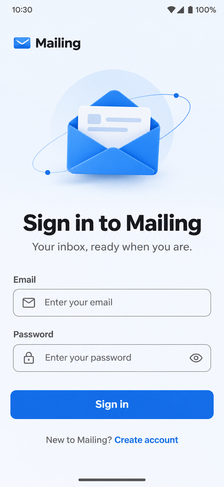

## Core mail screens

**Screens:** Inbox, Message/Thread, Compose.

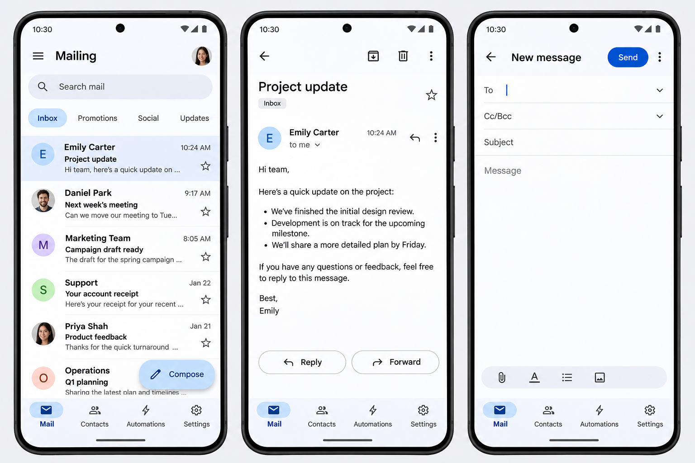

## Account screens

**Screens:** Launch, Sign in, Create account.

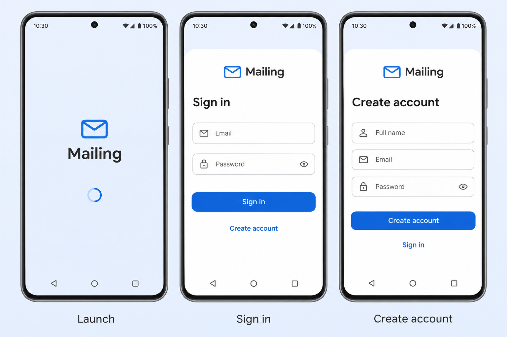

## Workspace setup

**Screens:** Profile step, Sending Defaults step, Integration step, Syncing state.

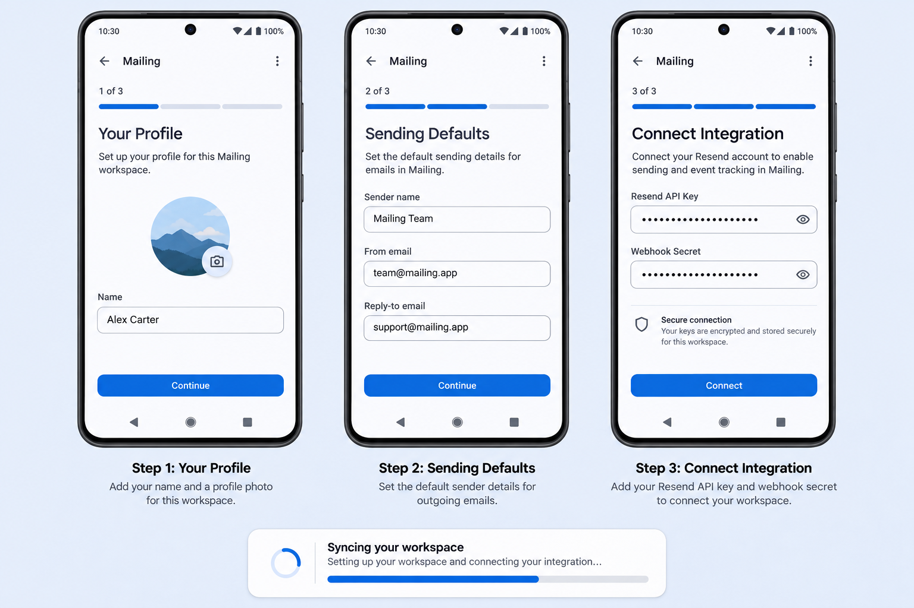

### Profile setup — focused concept

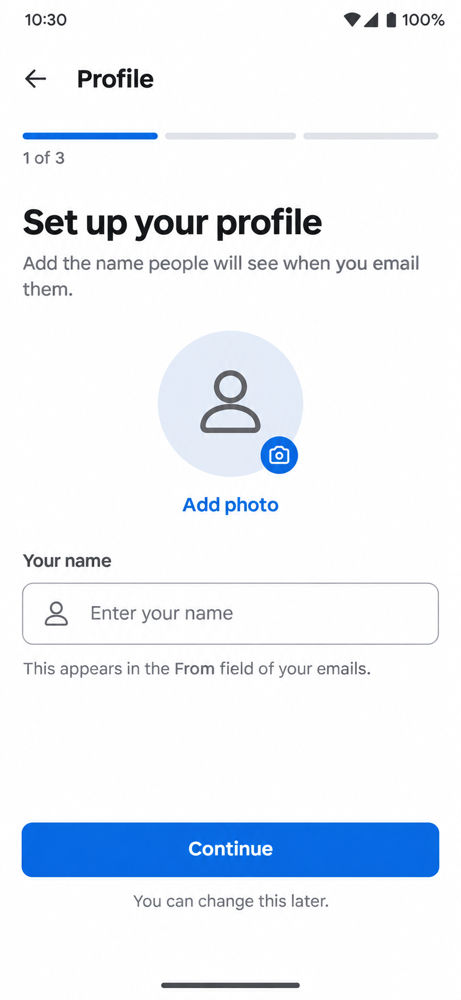

## Mail folder variations

**Screens:** Starred, Sent, Drafts.

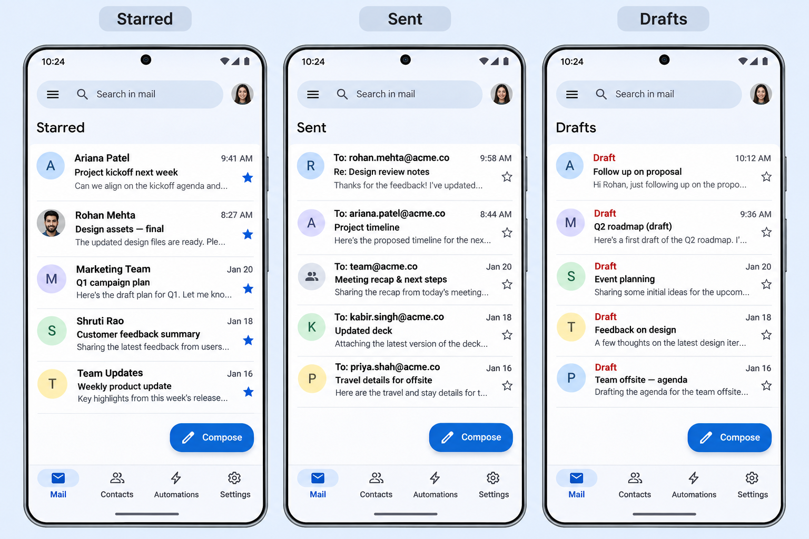

## Mail management and search

**Screens:** Archive, Trash, Custom Label, Search results.

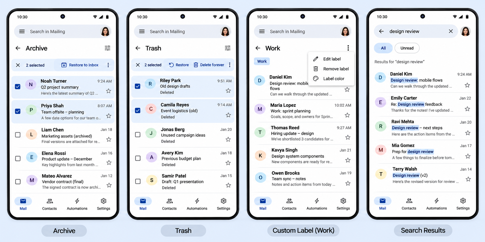

## Contacts

**Screens:** Contacts list, Add Contact form.

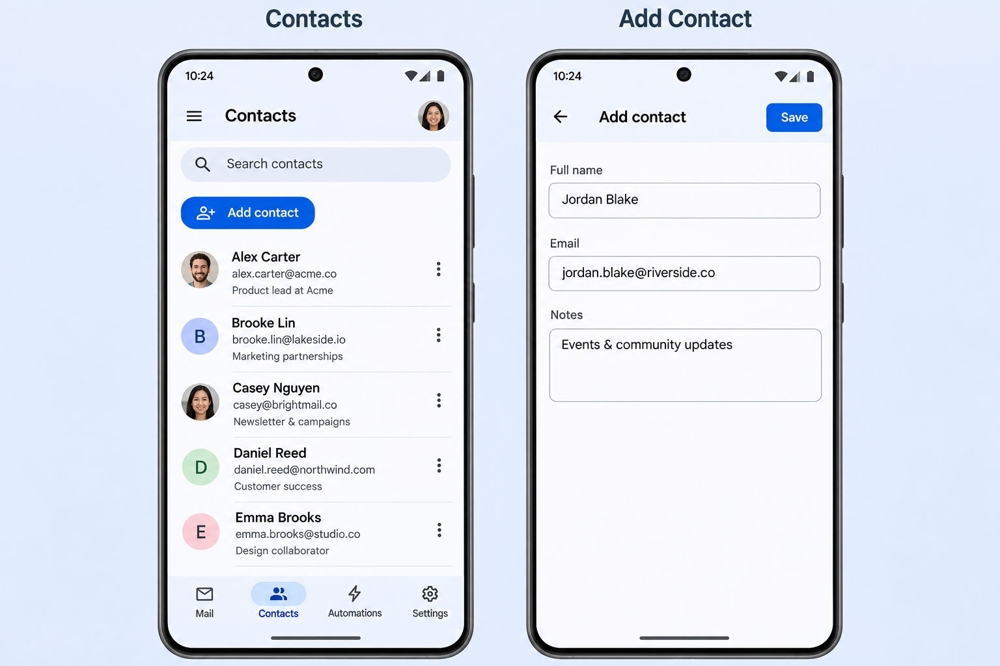

## Automations

**Screens:** Automations list, Workflow Builder, Execution History, Run Details.

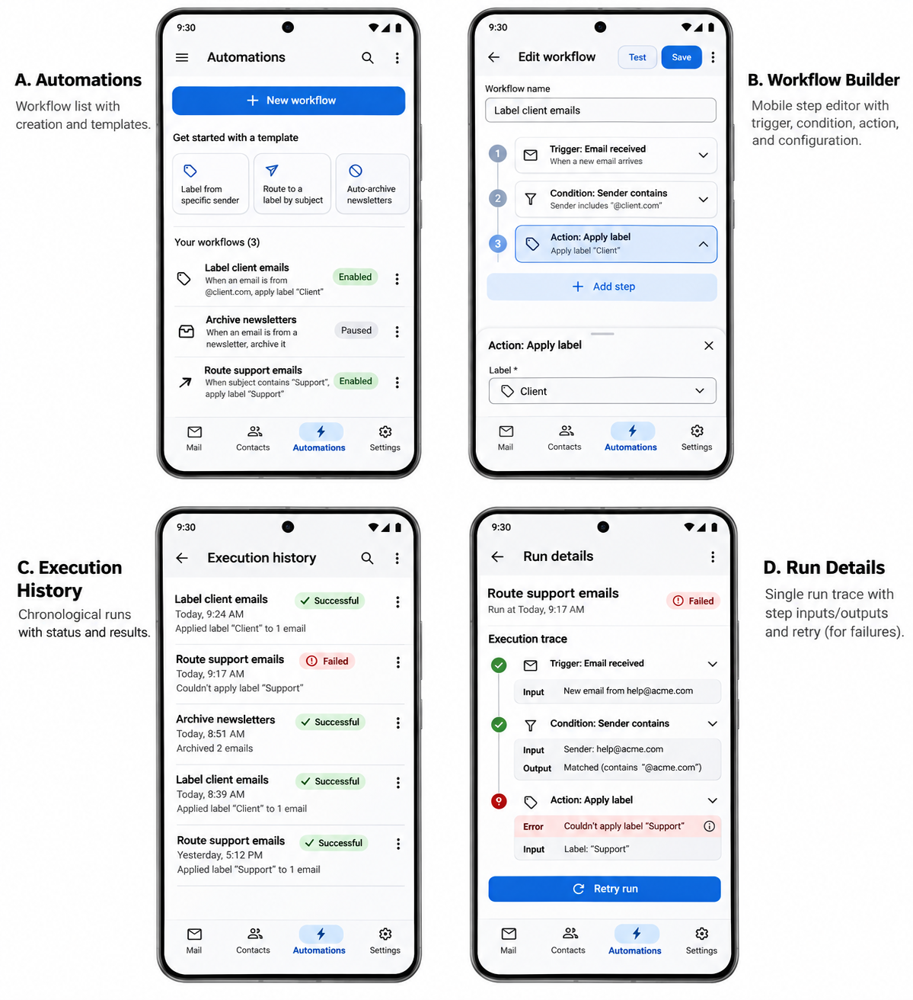

## Settings and account

**Screens:** Sending Defaults, Resend Integration, Danger Zone, Profile.

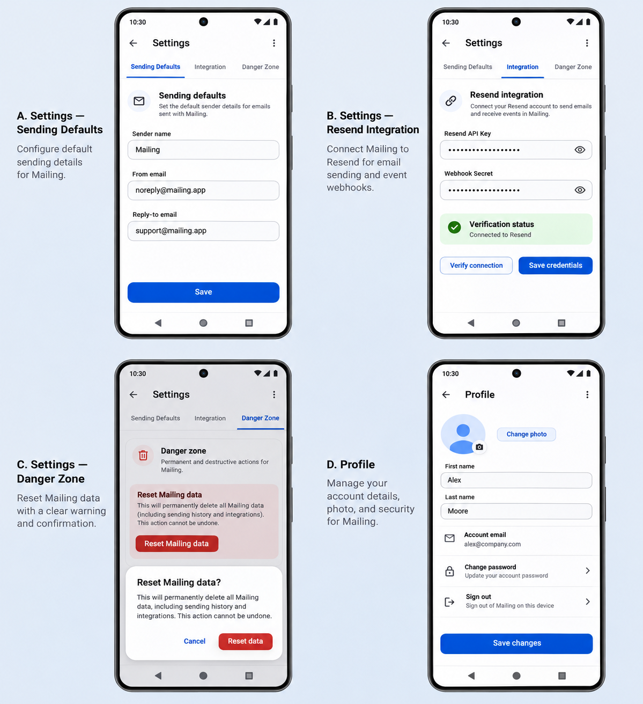

## Help, docs, and fallback

**Screens:** Help, Documentation index, Documentation article, Not found.

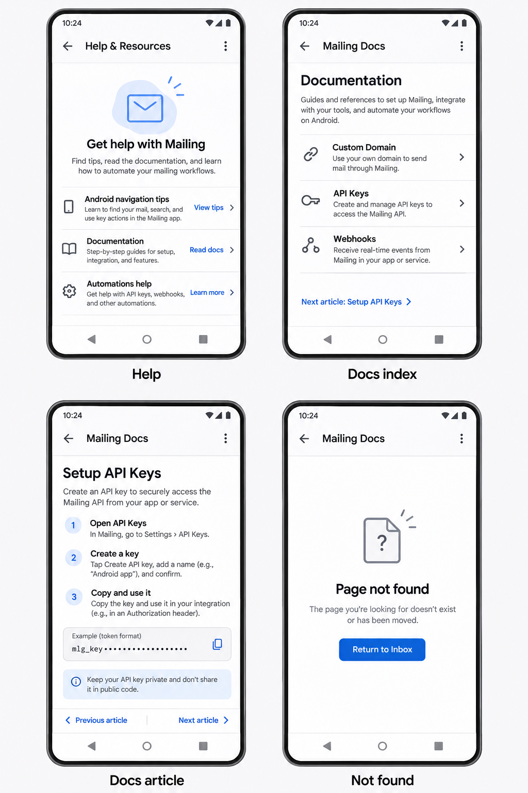

## Primary source

[UiClones — Gmail Clone V1.0 (Community), Figma](https://www.figma.com/design/xDK6ikbfCD7ZQ7xVgKxid3/UiClones---Gmail-Clone---V1.0--Community-?node-id=2-16)
